 

# Hi there 👋, I'm Deep

**I'm an Applied AI Engineer and consultant. I turn business problems into working AI products: credit risk models, RAG pipelines and analytics APIs, shipped end to end with tests, docs and honest evaluation.**

🟢 Taking on consulting and freelance projects, and open to full-time Applied AI / ML engineering roles.

[**Selected work**](#-selected-work) · [**Tech stack**](#-tech-stack) · [**How I work**](#-how-i-work) · [**Contact**](#-lets-work-together)

---

## 📊 Work in numbers

---

## 🚀 Selected work

<table>
<tr>
<td width="50%" valign="top">

### [Credit Decisioning Engine](https://github.com/deepbendale231/credit-decisioning-engine)
Rules, then a calibrated XGBoost risk model, then an approve / refer / decline policy with SHAP reason codes. FastAPI, Streamlit, CI, Docker.

- ROC-AUC **0.763** on a held-out test split
- **+3.84 pts** approvals vs the best tuned rules at the same default rate
- Model card, fairness audit, drift monitor, runbook

  

</td>
<td width="50%" valign="top">

### [Digital Lending Journey Teardown](https://github.com/deepbendale231/lending-journey-teardown)
A product teardown of a digital lending flow: friction log, RBI digital-lending checklist, RICE prioritisation, user stories, PRD, A/B test plan and metrics tree.

- Evidence-led, backed by 21 screenshots
- Compliance checklist signed off after a full re-read

 

</td>
</tr>
<tr>
<td width="50%" valign="top">

### [RAG Teaching Assistant](https://github.com/deepbendale231/RAG-BASED-Teaching-LLM)
Turns video lectures into a searchable index (transcribe, chunk, embed, retrieve) and answers with the video and timestamp to watch, using a local LLM.

- 11 videos, 105 timestamped chunks
- Local embeddings and local llama3.2 via Ollama

  

</td>
<td width="50%" valign="top">

### [Pollution Analytics](https://github.com/deepbendale231/Pollution-Analytics)
Air-quality analysis and AQI prediction across Indian cities: 3,240 readings across 270 cities, a Random Forest model (R² 0.95, MAE 6.4), FastAPI backend and Streamlit dashboard.

- Delhi-NCR cities dominate the top-10 most polluted
- Streamlit dashboard and FastAPI backend

  

</td>
</tr>
</table>

Also: [Uber NCR Ride Analytics](https://github.com/deepbendale231/Uber-Analytics) (150K bookings, API and dashboard) and [HouseIQ](https://github.com/deepbendale231/House-Prediction-ML-Model-) (house-price model with a Next.js frontend).

---

## 🛠 Tech stack

---

## 🧭 How I work

<table>
<tr>
<td width="33%" valign="top"><b>📏 Measure honestly</b> Baselines first, held-out test sets, confidence intervals, and a benchmark that is not a strawman.</td>
<td width="33%" valign="top"><b>📦 Ship the whole thing</b> API, UI, tests, CI, a model card and a runbook, not just a notebook.</td>
<td width="33%" valign="top"><b>📝 Write down the decisions</b> Each project explains what was chosen, what was cut and why.</td>
</tr>
</table>

---

## 🤝 Let's work together

I consult on and build applied AI projects end to end: scoping the problem, modelling, the API and UI, and a deployed, documented service.

Built with care from data to deployment.

