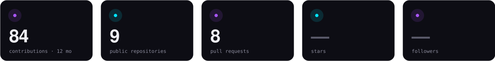
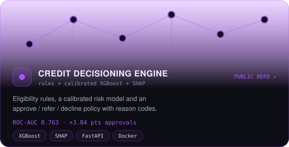
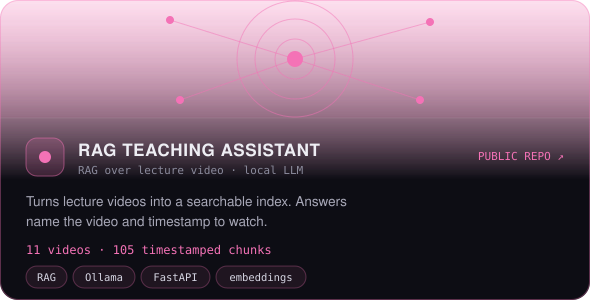
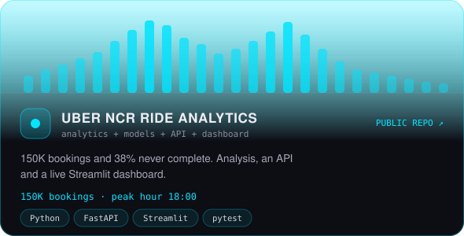
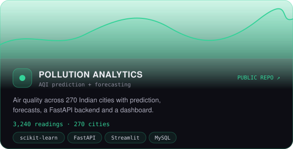
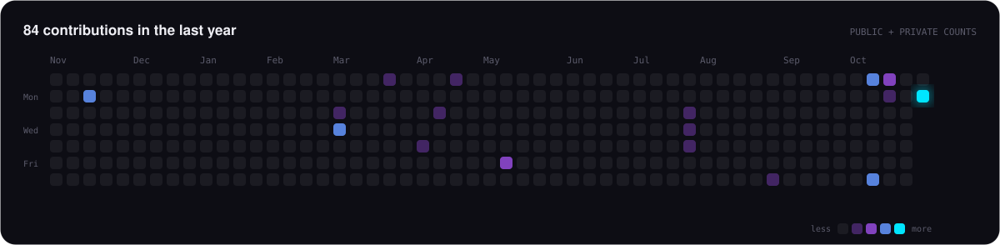
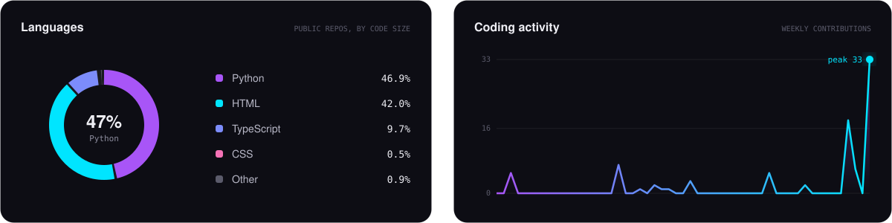
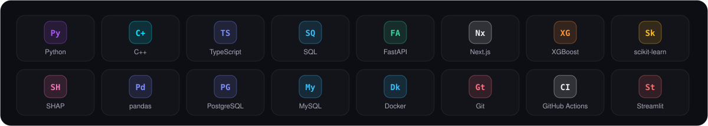

[**About**](#-about) · [**Systems**](#-featured-systems) · [**Activity**](#-activity) · [**Experience**](#-experience) · [**Stack**](#-stack) · [**Contact**](#-contact)

 

## 👤 About

 

## 🧩 Featured systems

<table>
<tr>
<td width="50%"></td>
<td width="50%"></td>
</tr>
<tr>
<td width="50%"></td>
<td width="50%"></td>
</tr>
</table>

Also: [Digital Lending Journey Teardown](https://github.com/deepbendale231/lending-journey-teardown) (PRD, RICE, RBI checklist, A/B plan) · [Uber live dashboard](https://uber-analytics.onrender.com) · [HouseIQ](https://github.com/deepbendale231/House-Prediction-ML-Model-)

## 📈 Activity

## 💼 Experience

### Software Engineering Intern, DAW Plugin Feature Lead · [Ainsemble](https://ainsemble.com/products/daw-plugin)
Jun 2026 to present &nbsp;·&nbsp; <a href="https://ainsemble.com/products/daw-plugin">ainsemble.com/products/daw-plugin</a>

Sole engineer responsible for architecting and building Ainsemble's DAW plugin from the ground up, through backend integration, cross-platform implementation, release engineering and beta testing.

- **End-to-end product engineering:** owned the full feature lifecycle, from requirements and architecture to implementation, testing and release. About 34,000 lines of native C++ across 129 source files, plus a React/TypeScript WebView interface.
- **Cross-platform DAW development:** a JUCE 8 / C++17 plugin for AU, VST3 and Standalone. macOS universal binaries for Apple Silicon and Intel, with Windows build and installer automation.
- **Backend integration:** reverse-engineered the undocumented production architecture across Django, FastAPI services, Azure Blob Storage, Elasticsearch and Firestore. Built API clients, authentication, session restoration, account management and cloud library sync.
- **Cloud sync and file management:** project export, import, download and restore, with bundle-aware handling of GarageBand and Logic projects, resumable Azure block uploads, upload-link refresh, duplicate handling and integrity checks.
- **Automatic project versioning:** a checkpointed, lock-protected versioning engine using semantic file fingerprints, atomic persistence, cross-process locking and change detection, so duplicate versions and unsafe uploads are prevented.
- **Reliability and reverse engineering:** fixed hard issues with GarageBand bundles, FL Studio project parsing and sample relinking, credential persistence, sync and session restoration, and added safeguards against accidental overwrites and inconsistent project states.
- **Security:** per-host credential storage in macOS Keychain and Windows Credential Manager, JWT session restoration, and automatic scrubbing of sensitive data from exported diagnostic logs.
- **Testing and release:** API, integration, concurrency and real-file round-trip tests, plus automated macOS and Windows packaging, including a signed, notarized and stapled universal macOS installer.
- **Beta delivery:** took the plugin through implementation, validation and beta delivery as part of Ainsemble's music collaboration platform.

 

### Data Science & Machine Learning Intern · New Vision Technologies and Engineers, Mumbai
Jan 2026 to May 2026

- Cut weekly reporting from about 3 hours to under 1 hour (over 65%) by automating ETL and report generation in Python and SQL
- Raised demand-forecast R² from 0.71 to 0.86 with XGBoost on 120K+ sales and inventory records
- Built Excel dashboards tracking 15+ KPIs for business stakeholders

## 🎓 Education

**B.Tech, Information Technology**: Dwarkadas J. Sanghvi College of Engineering, Mumbai · 2023 to May 2027 · CGPA 9.00 / 10
 Wharton Business Analytics · IIT Madras BS in Data Science (Foundation)

## 🛠 Stack

## 🤝 Contact

